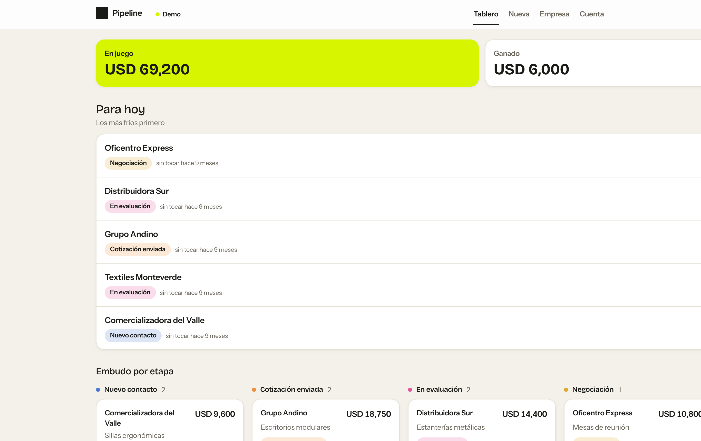
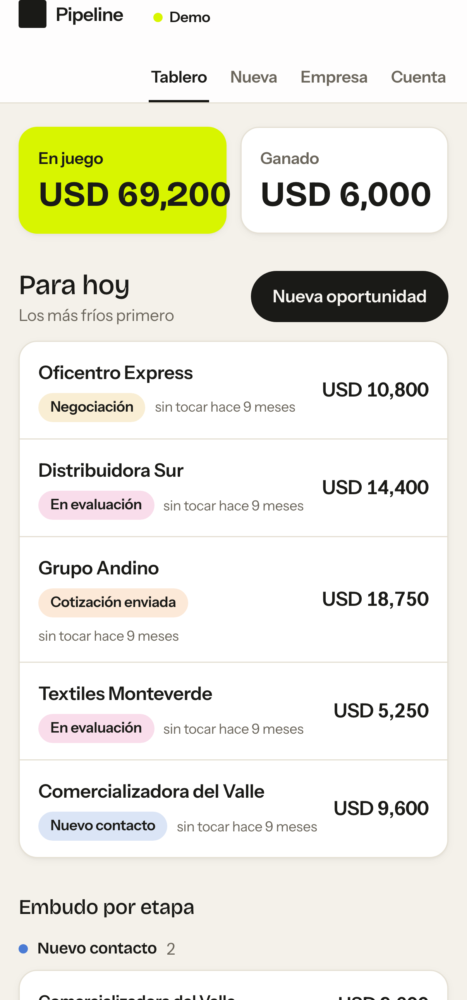

<div align="center">

# 🤝 Pipeline

### A white-label sales CRM: track leads through a configurable funnel, from your phone.

[](https://react.dev)
[](https://www.typescriptlang.org)
[](https://vite.dev)
[](https://supabase.com)
[](#architecture)
[](#status)

<br>



</div>

> **Status.** Work in progress. The demo runs end to end; I'm still refining the Supabase live mode and the design. Expect changes.

---

## What it does

A sales CRM you run from your phone. It keeps every lead on one board: how much money is in play, how much is won, which leads have gone cold, and where each one sits in the funnel. The same code runs two ways, chosen by one env variable:

- **Demo mode** (default): everything in the browser on `localStorage`, with seeded example data. For sales demos and portfolio use. No backend, no sign-up.
- **Live mode**: a real [Supabase](https://supabase.com) backend (Postgres, Auth, RLS), multi-tenant so one deployment can serve many clients.

Neutral Latin-American Spanish out of the box. Mobile-first, light and dark, WCAG AA.

<div align="center">
<br>
<table>
<tr>
<td align="center" width="62%"><br><sub>The board, on desktop</sub></td>
<td align="center" width="38%"><br><sub>Built for the phone</sub></td>
</tr>
</table>
</div>

## White-label: two files

Everything client-specific lives in exactly two files. No client strings in components:

- [`src/config/brand.config.ts`](src/config/brand.config.ts): name, tagline, logo, palette, locale, currency, contact details, socials.
- [`src/config/pipeline.config.ts`](src/config/pipeline.config.ts): funnel stages, field labels, history-activity labels.

Currency and dates are formatted from `locale` and `currency`, so you never hardcode a symbol. Change the palette and both light and dark themes follow.

### The funnel

Stages are an ordered list. `nextStage()` advances one step; the last stage is terminal (closed) and cannot advance. The default funnel:

```
nuevo-contacto → cotización-enviada → en-evaluación → negociación → pedido-cerrado
```

Edit the list in `pipeline.config.ts` to fit any sales process.

## Quick start

```bash
pnpm install
pnpm dev
```

Open the app, and when the demo gate appears sign in with the password `demo` (this is **not** real security, it just hides the demo). The board loads with example leads.

## Run modes

Copy `.env.example` to `.env` and set `VITE_MODE`:

| Variable | Default | Meaning |
| --- | --- | --- |
| `VITE_MODE` | `demo` | `demo` = localStorage, `live` = Supabase |
| `VITE_DEMO_PASSWORD` | `demo` | Demo gate password (demo mode) |
| `VITE_SUPABASE_URL` | — | Supabase project URL (live mode) |
| `VITE_SUPABASE_ANON_KEY` | — | Supabase anon key (live mode) |

## Architecture

Clean, layered, dependencies point inward:

```
src/domain/          Pure, framework-free, fully unit-tested (stages, history, validation, lead ops)
src/application/     Use cases (LeadService) behind ONE repository port
src/infrastructure/  Adapters: localStorage, Supabase, in-memory; clock, id, seed
src/ui/              React 19 + React Router 7 screens, design system, auth
```

The backend seam is a single port, [`LeadRepository`](src/application/ports.ts), with two implementations wired in [`src/main.tsx`](src/main.tsx) by `VITE_MODE`. The port is `Promise`-based (`list/get/save/remove/resetToSeed`), so the same UI drives both the synchronous localStorage adapter and the remote Supabase adapter.

---

<div align="center">
<sub>Built by <a href="https://github.com/diego-salomon">Diego Salomón</a>. · <a href="https://www.linkedin.com/in/diegosalomon">LinkedIn</a></sub>
</div>
